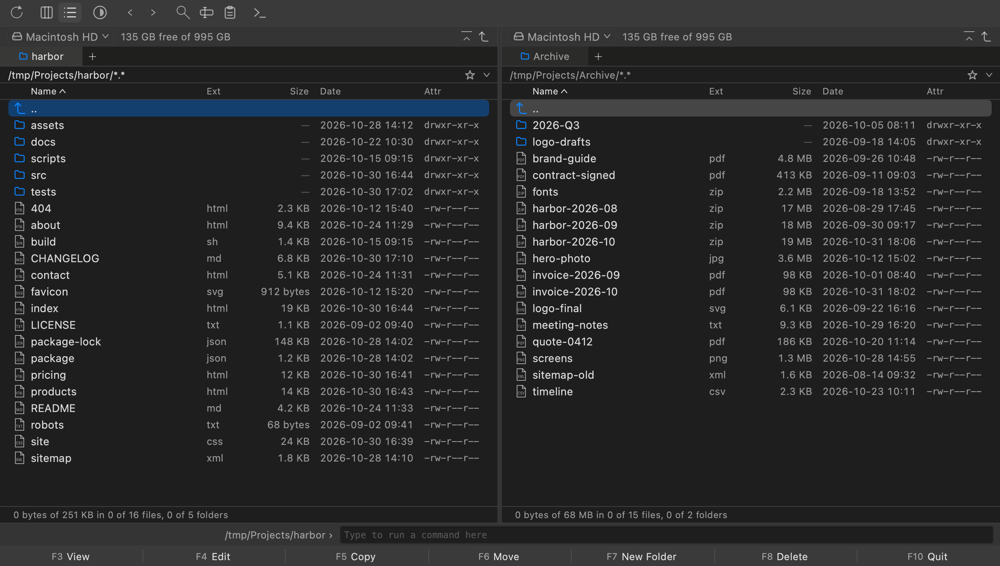

# Iniscape Commander

A dual-pane file manager for macOS, Windows and Linux, built for speed:
the window never waits on a slow disk or network, and copies are instant
clones where the file system allows.

Free, including for commercial use. More info at
[iniscape.com/commander](https://iniscape.com/commander).

## What it does

- **Copy and keep working.** File operations run in a background queue,
  unblocking concurrent work.
- **Viewer for text and images.** Built for speed: a file of any size
  opens at once.
- **Find Files and Multi-Rename.** Find by name and content; rename many
  files at once, with a preview.
- **Folder tabs and a hotlist.** Each panel keeps its tabs across
  launches; the hotlist holds favourites.
- **Two-panel navigation.** Each panel follows its folder, updating
  itself as files change.
- **Zip archives open as folders.** Browse, view and copy out; archives
  are read-only.

Every action has a key, so the mouse is never needed, and the window is
light or dark, or follows the system.

## Install

**macOS and Linux**

    curl -fsSL https://github.com/iniscape/commander/releases/latest/download/install.sh | bash

**Windows (PowerShell)**

    powershell -ExecutionPolicy Bypass -c 'irm https://github.com/iniscape/commander/releases/latest/download/install.ps1 -OutFile $env:TEMP\install.ps1; & $env:TEMP\install.ps1'

Requirements: macOS 12+ on Apple silicon, Windows 10+ on x64 or
Linux (glibc 2.28+) on x86_64.

It installs for the current user, without admin rights: in
`~/Applications` on macOS, `%LOCALAPPDATA%\Programs` on Windows and
`~/.local` on Linux.

## Uninstall

Uninstalling removes the app and its settings, log and caches.

**macOS and Linux**

    curl -fsSL https://github.com/iniscape/commander/releases/latest/download/uninstall.sh | bash

**Windows**: Settings → Apps → Installed apps → Iniscape Commander →
Uninstall, or in PowerShell

    powershell -ExecutionPolicy Bypass -c 'irm https://github.com/iniscape/commander/releases/latest/download/uninstall.ps1 -OutFile $env:TEMP\uninstall.ps1; & $env:TEMP\uninstall.ps1'

## Notes

- **Function keys on a Mac** want fn held, unless System Settings →
  Keyboard → *Use F1, F2, etc. keys as standard function keys* is on.
- **Windows 11 Smart App Control** may block a new release from starting,
  since the app is not code-signed yet, most often in the first hours
  after the release is out. Try again later.

## Privacy

Iniscape Commander does not collect, share or sell any personal data.
There is no Iniscape account, and no built-in analytics, telemetry, crash
reporting or advertising of any kind.

The app works on your files where they are. Once a day it asks github.com
whether a newer version is out, sending only its version, unless you
turn that off in Settings; an update is downloaded only when you choose
to install it. Everything else the app keeps, its settings and its log,
stays on your computer. The full statement is in the app: About →
*Privacy*.

## Reporting a bug

Open an issue with the
[bug report form](https://github.com/iniscape/commander/issues/new/choose).
It asks for the version (shown in About), your OS and the log: About →
*Show Log* shows the file, or find it at:

- macOS: `~/Library/Logs/Iniscape/Commander/commander.log`
- Windows: `%LOCALAPPDATA%\Iniscape\Commander\commander.log`
- Linux: `~/.local/state/iniscape-commander/commander.log`

Feature requests are welcome through the same page. They are read and
noted, then closed, as there is no public backlog. For security issues,
see [SECURITY.md](SECURITY.md).

## Changes

See [CHANGELOG.md](CHANGELOG.md).

## Licence

Copyright (c) 2026 Iniscape. All rights reserved. The Qt libraries that
come with the app are licensed under the LGPLv3; see *Licenses* in the
About dialog, which also lists the other third-party code. The licence
texts come with the app.
